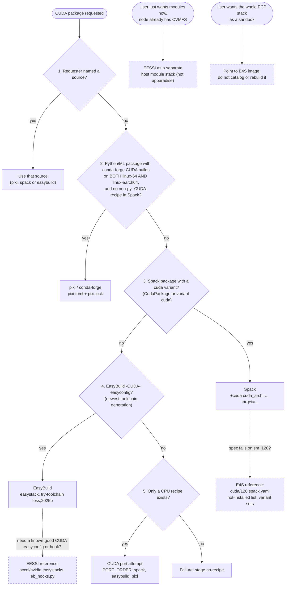

# Decision tree: which tool for a CUDA package

This file summarises when to use EasyBuild, Spack, pixi/conda-forge, EESSI and E4S, from the
apparadise point of view. Every fact comes from the other reference files in this folder
(`pixi-conda.md`, `spack.md`, `easybuild.md`, `eessi.md`, `e4s.md`). **(unverified)** marks are
carried over from them. Nothing here is a new product decision: anything not covered by
CLAUDE.md or `QUESTIONS.md` goes to `QUESTIONS.md`.

Contents:
1. The two questions
2. Flowchart (Mermaid)
3. Same tree as plain text
4. The apparadise build-source path, node by node
5. Complementary uses of EESSI and E4S (outside the resolver)
6. Per-target notes (`vr`, `rtx`, `generic`)
7. Comparison table

## 1. The two questions

There are two separate questions, and only the first one is the resolver:

- **A. "Which source builds the apparadise image?"** The answer is always exactly one of pixi,
  Spack or EasyBuild (or a port attempt, or a `no-recipe` failure), chosen in a fixed order.
- **B. "What else can help?"** EESSI and E4S never build an apparadise image. EESSI is a
  reference for CUDA easyconfigs and hooks, and an optional host module stack on CVMFS nodes.
  E4S is a reference for Spack environments and known sm_120 failures. They sit beside the
  resolver, never inside it.

## 2. Flowchart (Mermaid)



Dashed nodes are outside the resolver. They never produce an apparadise image.

## 3. Same tree as plain text

```
CUDA package requested
|
+-- [A] apparadise build source (resolver, fixed order, exactly one source per image)
|   |
|   +-- 1. Requester named a source? ---------------- yes --> use it (pixi | spack | easybuild)
|   |      no
|   +-- 2. Python/ML, conda-forge CUDA builds on
|   |      BOTH linux-64 AND linux-aarch64, and
|   |      Spack has no non-py- CUDA recipe? -------- yes --> pixi / conda-forge
|   |      no
|   +-- 3. Spack package with a `cuda` variant? ----- yes --> Spack (+cuda cuda_arch=<target list>)
|   |      no                                                 \__ fails on sm_120? see [B2]
|   +-- 4. EasyBuild `-CUDA-` easyconfig? ----------- yes --> EasyBuild (easystack, foss,2025b bump)
|   |      no                                                 \__ need a known-good recipe? see [B1]
|   +-- 5. Only a CPU recipe? ----------------------- yes --> CUDA port attempt (spack, easybuild, pixi)
|   |      no
|   +-- 6. --------------------------------------------------> failure, stage `no-recipe`
|
+-- [B] complements (outside the resolver, never an apparadise image)
    |
    +-- B1. EESSI
    |     +-- seeding/debugging an EasyBuild CUDA recipe --> read EESSI easystacks + eb_hooks.py
    |     +-- user wants plain Lmod modules, node has CVMFS --> EESSI host stack (separate)
    |     +-- laptops / cloud / CI with the same stack --> EESSI
    |
    +-- B2. E4S
          +-- writing a Spack spec for an E4S product --> borrow variant set from E4S spack.yaml
          +-- Spack build fails for cuda_arch=120/90 --> check E4S "not installed" list
          +-- "is this library sm_120-ready?" --> check E4S cuda/120 env and cache index
          +-- user wants the whole ECP stack now --> point to ecpe4s image (outside catalog)
```

## 4. The apparadise build-source path, node by node

The order is fixed by CLAUDE.md and implemented in `web/apparadise/resolver.py`. The checks
below are what the index (`web/apparadise/index.py`) and the references actually test.

### Node 1: requester's choice

- If the request names `pixi`, `spack` or `easybuild`, that source is used. Rule 1 always wins.
- Still one source per image: a requested source is never combined with another.

### Node 2: pixi / conda-forge

Concrete check (`index.py:scan_conda`, resolver rule 2). All must hold:

- `has_cuda`: in the `repodata.json` of a subdir, a build string contains `cuda` **or** a
  dependency matches `^(cuda-version|cudatoolkit|cuda-cudart|cuda-nvrtc|libcublas)`.
- CUDA builds in **both** `linux-64` and `linux-aarch64` (`CONDA_SUBDIRS <= arches`). `noarch`
  is not scanned.
- `is_python`: depends on `python` or `python_abi`, or the name matches `PYTHON_HINT`.
- **not** `compiled_in_spack`: Spack has no non-`py-` CUDA recipe. So GROMACS and LAMMPS, which
  ship Python bindings on conda-forge, still go to Spack.

Manual checks: `pixi search -c conda-forge -p linux-aarch64 --json <pkg>`, the feedstock's
`.ci_support/linux_aarch64_*cuda_compiler_version*` files (current recipe only), or repodata.

State on 2026-11-01: PyTorch, jaxlib, CuPy and vLLM pass (both arches). **TensorFlow fails**
(no linux-aarch64 CUDA job) and falls through to Spack or a port attempt.

What the recipe gets: one platform per target, `cuda = "<major>"` (13 for `rtx`/`vr`, 12 for
`generic`), and `build = "*cuda*"` when the index saw a `cuda` build string. Lock/solve failure
→ `concretize`; install failure → `build`.

### Node 3: Spack with a `cuda` variant

Concrete check (`index.py:scan_spack`): `package.py` contains `CudaPackage` or `variant("cuda"`,
in a `spack-packages` checkout (`repos/spack_repo/builtin/packages/*/package.py`). Manual:
`spack pkg grep -l CudaPackage`, `spack info --all <pkg>`.

`cuda_arch` values per target (from `containers/targets.yml` as rendered):

| Target | `cuda_arch` | CUDA external | Spack `target=` |
|---|---|---|---|
| `rtx` | `120` | 13.0.3 | `x86_64_v4` |
| `generic` | `75,80,86,89,90,100,120` | 13.0.3 | `x86_64_v3` / `aarch64` |
| `vr` | none (`cuda_arch: null`, Q13; render refuses) | 13.0.3 | `neoverse_v2` |

Minimum CUDA per value: `120` 12.8+, `120f` 12.9+, `110*` 13.0+, `70` only `cuda@9.0:12.9`.
Rubin `107/107a/107f` exist only in spack-packages `develop` and `releases/v2026.10`, require
`cuda@13.4:`, and are absent from `releases/v2026.06` (Spack 1.2.2's default) **(unverified
against NVIDIA or hardware)**.

Also check before queueing: the package must not need a CUDA newer than the target's base image
(Spack never builds `cuda` here), and the spec must fit `SPEC_RE` (no paths or quotes).
`concretize` failures may be repaired by `switch_source` (to EasyBuild).

### Node 4: EasyBuild CUDA easyconfig

Concrete check (`index.py:scan_easybuild`): an easyconfig whose **file name contains `-CUDA-`**
or whose text has a `('CUDA', ...)` dependency. `pick_easyconfig` keeps the file with the newest
generation per version. Manual: `eb -S 'foss-2025b-CUDA'`,
`ls easybuild/easyconfigs/*/*/*-CUDA-*.eb`.

Toolchain generation matters:

| Generation | GCC | CUDA in central repo |
|---|---|---|
| 2023a | 12.3.0 | 12.1.1 |
| 2023b | 13.2.0 | 12.4.0 |
| 2024a | 13.3.0 | 12.6.0 |
| 2025a | 14.2.0 | 12.8.0 |
| **2025b** (platform toolchain today) | 14.3.0 | 12.9.1 |
| 2026.1 | 15.2.0 | 13.3.0 (most packages) |

- The renderer bumps to `try-toolchain: foss,2025b` (Q22: try the latest first, fall back to the
  documented one). Moving to 2026.1 is an owner decision.
- Old generations (≤ 2023a) make the bump cascade into many tweaked dependencies; expect
  failures.
- The index ranks generations by year, then `a`/`b` or `.N`, so `2026.1` beats `2025b`.
- `cuda-compute-capabilities` is the dotted form of `cuda_arch` (`120` → `12.0`, `120f` → `12.0f`).

### Node 5: CUDA port attempt

Only a CPU recipe exists. The port tries sources in `PORT_ORDER = spack, easybuild, pixi`.

### Node 6: `no-recipe`

Nothing exists in any source. The failure is recorded with stage `no-recipe` and appears in the
public failure database (restricted packages excepted).

## 5. Complementary uses of EESSI and E4S (outside the resolver)

Neither tool is a resolver step, image base or builder mirror. Proposing that is an owner
decision for `QUESTIONS.md`.

### EESSI

| Situation | Use |
|---|---|
| Seeding or debugging an apparadise EasyBuild CUDA recipe | Read `EESSI/software-layer/easystacks/software.eessi.io/<ver>/accel/nvidia/*.yml` (easyconfigs that built and passed on sm_90/100/120) and `eb_hooks.py` in `software-layer-scripts` (CUDA workarounds, e.g. CUDA 12.8.0 lacking `10.0f`/`12.0f`). 2025.06 uses `foss/2025b`, the same as apparadise. |
| A user just needs modules on a host that already has CVMFS | EESSI as a separate host Lmod stack (`source /cvmfs/software.eessi.io/versions/2025.06/init/bash`). Not an apparadise product; don't mix module trees. |
| Same stack on laptops, cloud VMs, CI and several sites | EESSI. |
| Hardware is Grace/GH200 (cc90) or B200 (cc100) on supported CPUs | EESSI has native or validated builds. |

Don't reach for EESSI when the deliverable must be an OCI image, for CUDA PyTorch/TensorFlow/JAX
(EESSI has none), for `vr` (no Rubin target, Vera detection unverified), when nodes cannot run
FUSE/CVMFS, or for restricted software.

### E4S

| Situation | Use |
|---|---|
| Writing a Spack spec for PETSc, Trilinos, hypre, Kokkos, LAMMPS, GROMACS, ... | Borrow the variant set from `E4S-Project/e4s` `environments/*/gnu/cuda/{90,120}/spack.yaml`. |
| A Spack build fails on `cuda_arch=120` (or 90) | Check the commented-out "not installed" block in `environments/x86_64/gnu/cuda/120/spack.yaml`: cabana (kokkos 4.6 "Unsupported CUDA arch: 120"), cp2k (cuda_arch whitelist), dealii (`+cuda ^cuda@12:` conflict), mfem (OOM), lbann/dihydrogen (`CUDA::nvToolsExt`), exago (fmt), paraview+cuda (unsat), ascent. Read it from `master` (26.11 in progress). |
| "Is library X sm_120-ready at all?" before queueing `rtx` | E4S 26.06 builds gromacs, lammps, petsc, hypre, ginkgo, magma, trilinos, kokkos 5.1.1, raja, umpire, slate, sundials, superlu-dist, heffte, adios2, vtk-m for CC 12.0 (observed in the cache index). |
| User wants the whole ECP stack as a sandbox now | Point them to `ecpe4s/e4s-cuda:26.06-cuda120` (rtx) or `-cuda90` (GH200) via `enroot import`; pin by digest. Not cataloged, not rebuilt. |

Don't use E4S for an apparadise catalog image (monolithic, non-NGC), for `vr` or sm_100/103,
for the AI/Python layer, for cache hits (target, CUDA and `cuda_arch` shape all differ), or for
MPI injection under Enroot (e4s-cl has no Enroot backend).

## 6. Per-target notes

### `rtx` (x86-64, RTX PRO 6000 Blackwell, sm_120)

- CUDA 13.0.3 base; Spack `target=x86_64_v4`, `cuda_arch=120`; EasyBuild
  `optarch GCC:-march=x86-64-v4`, `cuda-compute-capabilities 12.0`.
- pixi: PyTorch and JAX cover sm_120 as SASS plus PTX for 12.0. The recipe pins only the CUDA
  major, so `rtx` may get 13.4 user-space libraries on a 13.0 base **(unverified on real
  nodes)**.
- CUDA 13.0 allows host GCC ≤15 in Spack; GCC 16 needs CUDA 13.4.
- EESSI 2025.06/2026.06 has `accel/nvidia/cc120` (built as `12.0f`). E4S has `cuda120` envs and
  the sm_120 failure list (§5), but its binaries are `x86_64_v3` + CUDA 12.9.1, so no cache hits.
- `containers/targets.yml` uses plain `120`, not `120f`. The EasyBuild renderer's
  `f"{a[:-1]}.{a[-1]}"` would turn `120f` into `120.f`, so it must change before `f` targets go
  in.

### `generic` (sm_75–sm_120 + PTX, amd64 and arm64)

- **CUDA 13.0.3 like the other targets; Volta (sm_70) is dropped** (Q38, owner, 2026-11-01),
  because CUDA 13 cannot build sm_70. pixi recipes declare `cuda = "13"`.
- With CUDA 13.0 on every target, Spack's ban on GCC 15 with CUDA ≤12.9 no longer applies.
- Spack `cuda_arch=75,80,86,89,90,100,120`, `target=x86_64_v3` or `aarch64`. EasyBuild
  `7.5,8.0,8.6,8.9,9.0,10.0,12.0`, `optarch GCC:-march=x86-64-v3` / `GCC:-march=armv8.2-a`.
- E4S ships one `cuda_arch` per build, so no E4S binary matches the multi-arch list. EESSI picks
  per-CC directories at load time instead of one fat binary.

### `vr` (Vera Rubin NVL72, aarch64)

- **Rubin CC and Vera CPU target are still unverified (Q13).** `cuda_arch: null`, so Spack and
  EasyBuild renders refuse to start. Read `nvidia-smi --query-gpu=compute_cap` on the hardware
  and check against Spack archspec.
- Spack: `neoverse_v2` today. Archspec added `olympus` (Vera) on 2026-10-28; Spack develop has
  it, Spack 1.2.2 does not. Running `neoverse_v2` binaries on Vera is an assumption
  **(unverified)**. Rubin `107*` in spack-packages needs CUDA 13.4+, which may mean `vr` needs a
  newer CUDA than the 13.0 in `targets.yml` **(unverified)**.
- pixi: conda-forge has no aarch64 microarch levels, so binaries are generic armv8
  **(unverified per package)**; servers use the `sbsa` variant. Whether Rubin can JIT from
  `compute_120` PTX is unverified.
- **TensorFlow has no conda-forge linux-aarch64 CUDA build**, so it is not a pixi package on any
  target (rule 2 needs both arches).
- EESSI: no Rubin `accel` dir, and Vera may be detected as `aarch64/generic` rather than `grace`
  **(unverified)**. E4S: nothing for Rubin, nothing tuned for Grace/Vera. Neither helps answer
  Q13.

## 7. Comparison table

| | pixi / conda-forge | Spack | EasyBuild | EESSI | E4S |
|---|---|---|---|---|---|
| **What** | binary channel + lockfile manager | from-source package manager with solver | from-source framework with pinned easyconfigs | ready-built EasyBuild stack on CVMFS | curated Spack distribution |
| **Delivery form** | `.conda` binaries into an env; `pixi.lock` | source builds; `spack.yaml`/`spack.lock`; OCI build caches | source builds; install prefix + module per package | read-only CVMFS tree + Lmod modules | `spack.yaml` envs, signed binary cache, 30+ GB monolithic images |
| **CUDA arch coverage** | fixed by each feedstock (PyTorch 12.9: sm_50–sm_120+PTX; nvcc default ends at `121-virtual`); sm_70 only in CUDA 12.x | any `cuda_arch` list (`70`…`121f`; Rubin `107*` only in newer spack-packages) | any dotted `cuda_compute_capabilities`; sanity check wants PTX for highest | major CCs only: 7.0/7.5, 8.0, 9.0, 10.0, 12.0 | one per env: 80/86/89/90/120 (x86), 80/90/120 (aarch64); no sm_100/103 |
| **aarch64** | yes (sbsa); no microarch tuning; TensorFlow CUDA missing | yes; `neoverse_v2`, no `olympus` in 1.2.2 | yes (`armv8.2-a` for `generic`, `neoverse-v2` for `vr`) | yes, incl. `aarch64/nvidia/grace`; Vera unlisted | yes, generic `aarch64` only |
| **Containers** | multi-stage copy of the env; same prefix in both stages | `spack containerize`, or `buildcache push --base-image` | `--containerize` exists but apparadise writes its own Containerfile | no OCI images; bind `/cvmfs` into containers | Docker Hub `ecpe4s/*` multi-arch images, SIFs |
| **Role in apparadise** | build source, resolver rule 2 | build source, rule 3, first in port order | build source, rule 4 | complement: easyconfig/hook reference, optional host module stack | complement: reference Spack envs, known sm_120 failures |
